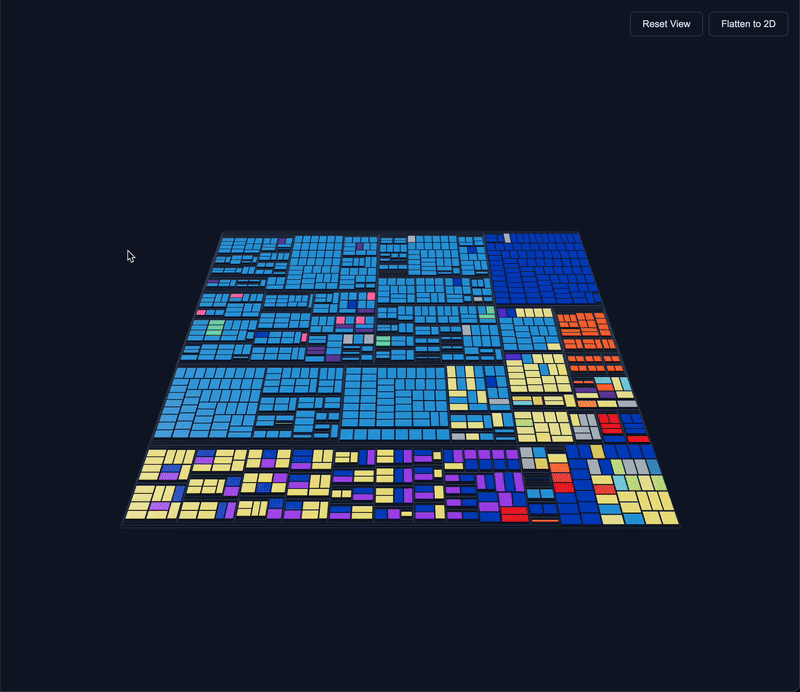
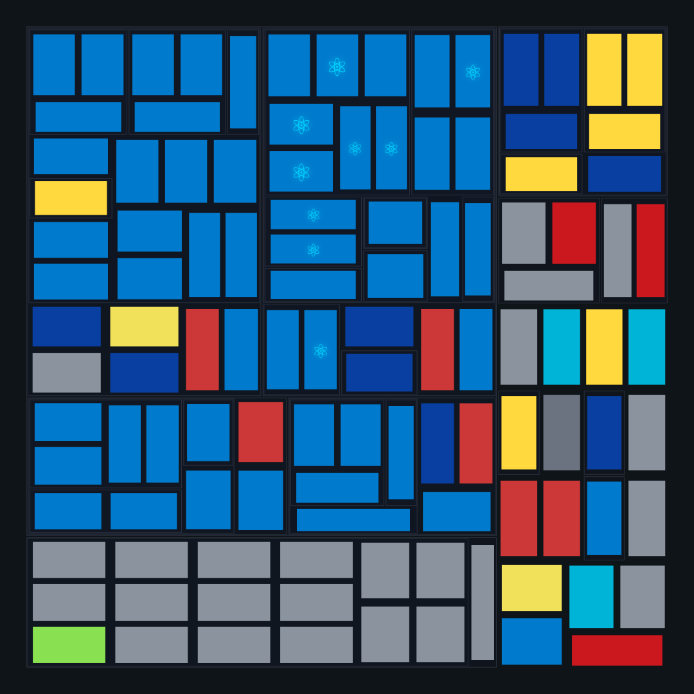
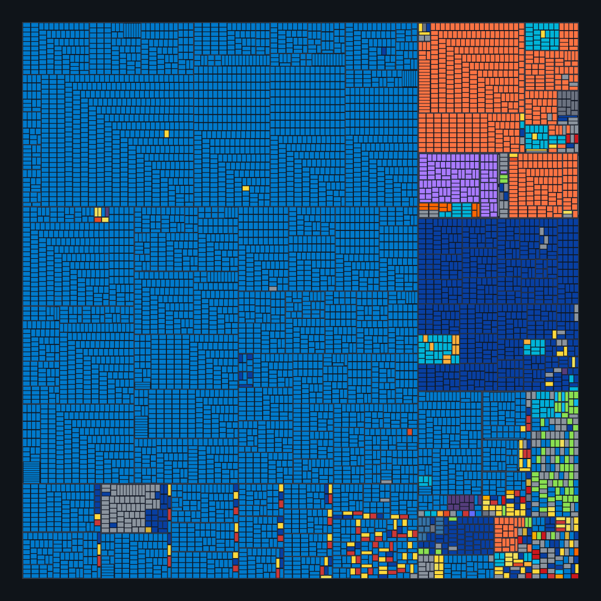
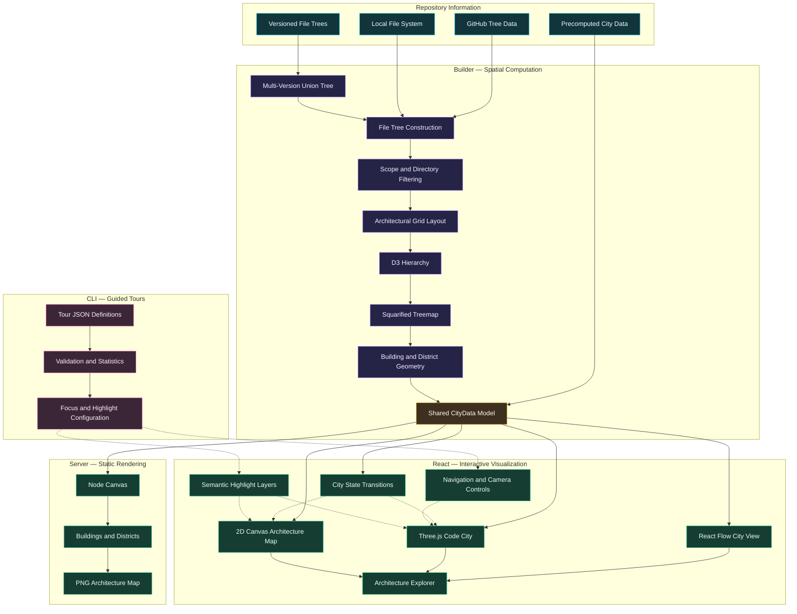

<div align="center">

  <h1>Codebase Topography</h1>

  <p>
    <strong>Every codebase has a landscape.</strong>
  </p>

  <p>
    A spatial software visualization toolkit exploring architectural
    mapping, hierarchical geometry, interactive 3D environments,
    and the visual evolution of source code through TypeScript,
    D3.js, and Three.js.
  </p>

  [](https://www.typescriptlang.org/)
  [](https://react.dev/)
  [](https://threejs.org/)
  [](https://d3js.org/)
  [](https://bun.sh/)
  [](#getting-started)

  <p>
    <a href="#overview">Overview</a> ·
    <a href="#visualization">Visualization</a> ·
    <a href="#spatial-modeling">Spatial Modeling</a> ·
    <a href="#architecture">Architecture</a> ·
    <a href="#temporal-visualization">Temporal Visualization</a> ·
    <a href="#getting-started">Getting Started</a>
  </p>

  

  <br />

  <sub>
    Software cartography · Computational geometry · Spatial information design
  </sub>

</div>

## Overview

Codebase Topography is a spatial visualization toolkit that
transforms hierarchical software structures into navigable
two-dimensional maps and three-dimensional virtual cities.

Instead of representing a repository exclusively through
conventional file explorers, the system introduces a spatial
metaphor in which files become buildings, directories become
districts, and software packages become distinct urban regions.

The resulting environment provides a visual perspective on
repository structure, file distribution, architectural boundaries,
and the evolution of software across different versions.

A shared geometric data model connects the layout engine
with multiple rendering implementations, allowing the same
codebase to be explored as an interactive map, a volumetric
city, or a static architectural image.

The project explores the intersection of:

- Software cartography and architecture visualization.
- Hierarchical spatial partitioning.
- Computational geometry and treemap algorithms.
- Interactive two-dimensional and three-dimensional graphics.
- Temporal visualization of software evolution.
- Semantic information visualization.
- Developer experience and codebase exploration.

Unlike conventional geospatial applications, the coordinates
represent an abstract software environment rather than
physical geographic locations.

## Visualization

### Architectural Cartography

<table>
  <tr>
    <td align="center" width="50%">
      <strong>Repository Overview</strong>
    </td>
    <td align="center" width="50%">
      <strong>Large-Scale Codebase</strong>
    </td>
  </tr>
  <tr>
    <td>
      
    </td>
    <td>
      
    </td>
  </tr>
  <tr>
    <td align="center">
      <sub>
        Hierarchical file organization and semantic
        color classification.
      </sub>
    </td>
    <td align="center">
      <sub>
        Spatial representation of a large and
        structurally diverse repository.
      </sub>
    </td>
  </tr>
</table>

Each rectangular region represents an individual file.
Nested boundaries preserve directory relationships,
while colors communicate file classifications or
additional semantic information.

The spatial representation makes it possible to identify
large subsystems, densely populated directories, and
patterns of file distribution without navigating each
directory individually.

### Two-Dimensional Architecture Map

The two-dimensional visualization provides a top-down
representation of repository geometry using Canvas.

Its principal capabilities include:

- Interactive pan and zoom.
- File and directory selection.
- Hierarchical district boundaries.
- Configurable semantic highlight layers.
- File names and file-type icons.
- Directory filtering and focused exploration.
- Automatic directory abstraction at lower zoom levels.
- Animated transitions between focused regions.

### Three-Dimensional Code City

The three-dimensional visualization transforms the same
planar layout into a volumetric environment using
React Three Fiber.

Files are represented as rectangular buildings with
configurable heights, while directory boundaries form
the underlying urban structure.

The renderer supports animated building growth,
orbital camera navigation, interactive selection,
semantic overlays, and multiple city sources within
a shared scene.

The transition between flat and volumetric representations
preserves the underlying spatial organization, helping
maintain visual context during navigation.

## Features

| Feature | Description |
| :--- | :--- |
| **Hierarchical Treemaps** | Recursive spatial organization using D3 hierarchy and squarified treemaps. |
| **2D Architecture Maps** | Interactive Canvas-based repository visualization. |
| **3D Code Cities** | Volumetric software environments powered by Three.js. |
| **Semantic Highlighting** | Configurable layers targeting individual files and directories. |
| **Grid-Based Layouts** | Organize related files into explicit architectural regions. |
| **Multi-City Visualization** | Display multiple repositories or packages within a shared spatial environment. |
| **Version Comparison** | Generate consistent spatial layouts across multiple repository versions. |
| **Animated Transitions** | Interpolate between city states and repository configurations. |
| **Directory Abstraction** | Reduce visual complexity through selective directory representation. |
| **Interactive Exploration** | Inspect files, focus on subsystems, and navigate hierarchical structures. |
| **Guided Tours** | Structured JSON-based walkthroughs for software architecture and onboarding. |
| **Static Image Generation** | Render repository maps into PNG images using server-side Canvas utilities. |
| **Reusable Components** | Integrate visualization primitives into existing React applications. |
| **Storybook Environment** | Explore interactive rendering scenarios and component configurations. |

## Spatial Modeling

The central idea behind Codebase Topography is the
transformation of a hierarchical file system into a
continuous spatial representation.

A repository can be modeled as a rooted tree:

$$
T=(V,E)
$$

Where:

- $V$ represents files and directories.
- $E$ represents hierarchical containment relationships.
- Internal nodes represent directories.
- Leaf nodes represent individual files.

The layout engine transforms this abstract hierarchy
into positioned geometric primitives.

### Spatial Metaphor

| Software Entity | Spatial Representation |
| :--- | :--- |
| Repository | City |
| Package or subsystem | Spatial region |
| Directory | District |
| Nested directory | Subdistrict |
| Source file | Building |
| File size or line count | Building height |
| File classification | Color and icon |
| Architectural grouping | Semantic layer or grid cell |
| Repository version | City state |
| Software evolution | Spatial transition |

The visualization is therefore a form of thematic
cartography applied to software information rather
than physical geography.

### Squarified Treemap Algorithm

The layout engine uses the `d3-hierarchy` library
to construct nested rectangular regions.

A squarified treemap recursively partitions an
available rectangular area according to the
hierarchical structure and assigned node weights.

Conceptually, a child region receives an area
proportional to its effective layout weight:

$$
A_i
\approx
A_P
\frac{w_i}{\sum_{j=1}^{n}w_j}
$$

Where:

- $A_P$ is the available area of the parent region.
- $A_i$ is the area allocated to child node $i$.
- $w_i$ represents the effective layout weight.
- $n$ represents the number of child nodes.

Actual rectangle dimensions also depend on padding,
hierarchical depth, sorting, and layout constraints.

The squarification process seeks to avoid excessively
elongated rectangles by improving their aspect ratios.

$$
R_i=
\max\left(
\frac{W_i}{H_i},
\frac{H_i}{W_i}
\right)
$$

A value closer to one corresponds to a more
square-shaped rectangle.

The current implementation uses unit weights when
no explicit file weight is available. Consequently,
footprint area should not automatically be interpreted
as proportional to source code size.

### Hierarchical Partitioning

Directories receive spatial regions containing their
descendant files and nested directories.

The layout engine supports:

- Recursive hierarchy construction.
- Configurable inner and outer padding.
- Depth-dependent padding functions.
- Directory and file sorting.
- Deep nesting management.
- Minimum visual size adjustments.
- Cached treemap results.

These mechanisms help preserve structural readability
as repository size and nesting depth increase.

### Building Geometry

Each file is converted into a spatial building
defined by a position and three dimensions:

$$
\mathbf{p}_i=(x_i,y_i,z_i)
$$

$$
\mathbf{d}_i=(w_i,h_i,d_i)
$$

For a treemap rectangle with bounds
$(x_0,z_0,x_1,z_1)$, the planar dimensions are:

$$
w_i=x_1-x_0
$$

$$
d_i=z_1-z_0
$$

The building center is calculated as:

$$
x_i=\frac{x_0+x_1}{2}
$$

$$
z_i=\frac{z_0+z_1}{2}
$$

The vertical position is derived from the
building height so that its base remains
aligned with the ground plane.

### Height Encoding

The builder derives an initial building height
from file size in bytes.

The implemented base-height function is:

$$
h(s)=4+36\min\left(\frac{s}{10000},1\right)
$$

Where $s$ represents file size.

This produces a base height between 4 and 40
scene units, saturating at 10,000 bytes.

The three-dimensional renderer additionally supports
linear and logarithmic height mappings based on
available file size or line-count metadata.

When line-count information is available, the
logarithmic mapping is:

$$
h(L)=2+12\log_{10}(\max(L,1))
$$

For linear line-count scaling:

$$
h(L)=2+k\max(L,1)
$$

Where $k$ represents the configured scale factor.

The renderer can also override heights for selected
file patterns, allowing files such as lockfiles
to remain visually flat.

These values describe visual encoding rather than
direct measurements of software complexity.

A taller building does not necessarily represent
more complex, less maintainable, or more important code.

## Architectural Grid Layout

Although conventional treemaps preserve directory
containment, software architecture does not always
align with physical directory organization.

Codebase Topography supports an additional grid-based
layout mechanism through the `CodebaseView` model.

This mechanism allows files to be assigned to
explicit spatial regions according to logical
architectural groupings.

For example:

```text
┌────────────────────┬────────────────────┐
│                    │                    │
│   Presentation     │   Application      │
│       Layer        │       Layer        │
│                    │                    │
├────────────────────┼────────────────────┤
│                    │                    │
│      Domain        │  Infrastructure    │
│       Layer        │       Layer        │
│                    │                    │
└────────────────────┴────────────────────┘
```

This illustration represents a possible custom
architectural configuration.

Each grid region can contain its own hierarchical
treemap and file selection.

| Configuration | Responsibility |
| :--- | :--- |
| Grid Coordinates | Determine the spatial position of an architectural group. |
| Reference Groups | Associate explicit file paths with a grid cell. |
| Priority | Resolve conflicting assignments between groups. |
| Scope | Restrict the visualization to selected repository regions. |
| Include Patterns | Select matching files before layout generation. |
| Exclude Patterns | Remove irrelevant files from the visualization. |
| Cell Padding | Control separation between architectural regions. |
| Labels | Identify logical groupings within the map. |

The default configuration uses a single-cell grid,
providing conventional hierarchical treemap behavior.

## Architecture

The repository is organized as a TypeScript monorepo
with independent packages for spatial computation,
interactive rendering, static image generation,
and command-line utilities.

A shared `CityData` representation separates
the geometric model from its visual presentation.



The diagram represents the conceptual relationships
between the repository packages and their major
computational responsibilities.

The visualization components consume spatial data
rather than requiring direct access to a Git
repository or local file system.

This separation allows the layout engine to be
used independently of React and Three.js.

## Technology Stack

<div align="center">

  

</div>

| Technology | Responsibility |
| :--- | :--- |
| **TypeScript** | Shared data models, algorithms, and component architecture. |
| **React 19** | Declarative visualization components and application state. |
| **Three.js** | Three-dimensional geometry and WebGL rendering. |
| **React Three Fiber** | React-based Three.js scene composition. |
| **React Three Drei** | Camera controls and supporting graphical utilities. |
| **React Spring** | Animated graphical transitions. |
| **D3 Hierarchy** | Hierarchical layout and squarified treemap computation. |
| **Canvas API** | Interactive two-dimensional architectural rendering. |
| **React Flow** | Node-based spatial visualization. |
| **Node Canvas** | Static image rendering outside the browser. |
| **Storybook** | Interactive component development and visualization scenarios. |
| **Bun** | Workspace management, compilation, and testing. |
| **Commander.js** | Command-line tour utilities. |

## Getting Started

### Requirements

- Bun 1.2.5 or a compatible release.
- A modern browser with WebGL support.
- Git.
- Node.js for tooling that requires the Node runtime.

The server-side rendering package uses native
Canvas bindings. Additional system dependencies
may be required depending on the operating system.

### Clone the Repository

```bash
git clone https://github.com/4beru/codebase-topography.git

cd codebase-topography
```

### Install Dependencies

The repository includes a Bun lockfile and
workspace configuration.

```bash
bun install --frozen-lockfile
```

### Build the Packages

```bash
bun run build
```

The root build command compiles the packages
in the following order:

1. Spatial layout builder.
2. React visualization components.
3. Server-side rendering utilities.
4. Command-line tour utilities.

Individual packages can also be built independently:

```bash
bun run build:builder
bun run build:react
bun run build:server
bun run build:cli
```

### Explore the Interactive Visualizations

The repository is primarily a reusable visualization
toolkit rather than a standalone web application.

Storybook provides the interactive development and
demonstration environment.

From the repository root:

```bash
bun run build:builder

cd packages/react

bun run storybook
```

Open:

```text
http://localhost:6006
```

The Storybook environment provides scenarios for
exploring the geometric layout, rendering modes,
semantic layers, and animated transitions.

### Available Demonstrations

| Scenario | Description |
| :--- | :--- |
| `2D3DComparison` | Compare planar and volumetric representations. |
| `FileCity3D` | Interactive three-dimensional software cities. |
| `ArchitectureMapGridLayout` | Architectural grid configuration. |
| `ArchitectureMapHighlightLayers` | Semantic file and directory visualization. |
| `MultiCitySideBySide` | Spatial comparison of multiple codebases. |
| `PackageSeparation` | Separation of software packages into distinct regions. |
| `CommitTransition` | Animated transitions between repository states. |
| `CommitTimelapse` | Sequential visualization of software evolution. |
| `DirectoryHide` | Animated directory visibility changes. |
| `TreeMapExplainer` | Educational exploration of treemap layout concepts. |
| `FileCityExplorerComponent` | Experimental architecture exploration interface. |
| `StressTest` | Rendering experiments with larger datasets. |

The complete scenario collection is located in:

[`packages/react/src/stories/`](./packages/react/src/stories/)

## Integration

The visualization toolkit exposes independent
building and rendering APIs.

The following examples use the existing internal
package identifiers retained by the repository.

### Generate City Geometry

```typescript
import {
  CodeCityBuilderWithGrid,
  buildFileSystemTreeFromFileInfoList,
} from '@principal-ai/file-city-builder';

const paths = [
  { path: 'src/index.ts', size: 1200 },
  { path: 'src/components/App.tsx', size: 4200 },
  { path: 'src/utils/math.ts', size: 1800 },
  { path: 'tests/math.test.ts', size: 2100 },
];

const files = paths.map(({ path, size }) => ({
  name: path.split('/').pop()!,
  path,
  relativePath: path,
  size,
  extension: '.' + path.split('.').pop(),
  lastModified: new Date(),
  isDirectory: false,
}));

const fileTree = buildFileSystemTreeFromFileInfoList(
  files,
  'example-snapshot',
);

const builder = new CodeCityBuilderWithGrid();

const cityData = builder.buildCityFromFileSystem(fileTree);
```

The generated `CityData` contains positioned
buildings, directory regions, spatial bounds,
and associated metadata.

### Render a Two-Dimensional Map

```tsx
import {
  ArchitectureMapHighlightLayers,
} from '@principal-ai/file-city-react';

<ArchitectureMapHighlightLayers
  cityData={cityData}
  enableZoom={true}
  showFileNames={true}
  onBuildingClick={(building) => {
    console.log(building.path);
  }}
/>
```

### Render a Three-Dimensional City

```tsx
import {
  FileCity3D,
} from '@principal-ai/file-city-react';

<FileCity3D
  cityData={cityData}
  height={600}
  heightScaling="logarithmic"
  animation={{
    startFlat: true,
    autoStartDelay: 500,
  }}
  onBuildingClick={(building) => {
    console.log(building.path);
  }}
/>
```

The visualization can transition from a flat
architectural map into a three-dimensional
representation of the same geometry.

### Highlight Architectural Regions

```tsx
const layers = [
  {
    id: 'test-files',
    name: 'Test Files',
    enabled: true,
    color: '#22c55e',
    items: cityData.buildings
      .filter((building) => {
        return building.path.includes('.test.');
      })
      .map((building) => ({
        path: building.path,
        type: 'file' as const,
      })),
  },
];

<FileCity3D
  cityData={cityData}
  highlightLayers={layers}
  isolationMode="transparent"
/>
```

This configuration emphasizes test files while
preserving the surrounding architectural context.

### Compare Repository Versions

```typescript
import {
  buildMultiVersionCity,
  type FileTree,
} from '@principal-ai/file-city-builder';

const versions = new Map<string, FileTree>();

versions.set('v1', fileTreeV1);
versions.set('v2', fileTreeV2);

const {
  unionCity,
  presenceByVersion,
  getVersionView,
} = buildMultiVersionCity(versions);

const firstVersion = getVersionView('v1');
const secondVersion = getVersionView('v2');
```

The supplied file trees share a unified spatial
layout while retaining version-specific file presence.

## Static Architecture Maps

The repository provides a rendering script
that scans a local directory and generates
a static PNG visualization.

The script combines file system traversal,
treemap computation, and server-side Canvas
rendering.

From the repository root, after building
the required packages:

```bash
bun scripts/test-render.ts . ./architecture.png
```

To visualize another repository:

```bash
bun scripts/test-render.ts \
    /path/to/repository \
    ./architecture.png
```

The script ignores several common generated
and dependency directories, including
`node_modules`, `.git`, and build output.

### Rendering Configuration

| Property | Default |
| :--- | :--- |
| Output Resolution | 1080 × 1080 |
| Output Format | PNG |
| Background | `#0f1419` |
| Directory Color | `#111827` |
| Default Building Color | `#36454F` |
| Layout | Hierarchical treemap |
| Rendering Backend | Node Canvas |

The generated images can be incorporated into
architecture documentation, technical presentations,
repository summaries, and software portfolio pages.

---

<div align="center">

  <h3>Architecture becomes a landscape.</h3>

  <p>
    Part of <strong>Geospatial Graphics</strong> — a collection
    of projects exploring geographic information, computational
    geometry, spatial visualization, and the digital reconstruction
    of real-world environments.
  </p>

  <p>
    <sub>Curated by Abel Ortega.</sub>
  </p>

  <a href="https://github.com/4beru">GitHub</a> ·
  <a href="https://www.aberu.site">Portfolio</a>

</div>
